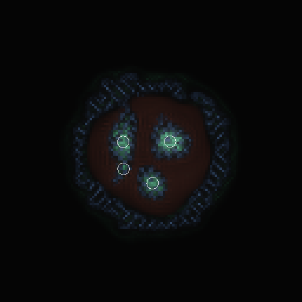

# flux-lenia

**Mass-conserving continuous cellular automata with learned local dynamics.**

A JAX workbench for studying emergence in multi-channel continuous fields
where mass is conserved by construction rather than by penalty. The local
update rule is a differentiable neural sensory-motor map; transport is
flux-form, so total mass is preserved to floating-point rounding
(`~1e-16` relative over thousands of steps) and cannot drift. An
accompanying oracle decides, with stated thresholds and controls, what
counts as an organism, a division, and a behaviour.

<p align="center">
  
  <br>
  <em>OSCILLIS (seed 442) at t=900. Circles are tracked organisms.</em>
</p>

```
engine/neural_field.py    the core: perception, brain, flow, transport
engine/novelty_oracle.py  complexity metrics, speciation tracking, anomalies
engine/render.py          shader-style compositing, GIF/MP4 recording
scripts/discover.py       the search loop (screen -> curate)
scripts/selftest.py       verification; run this before trusting a result
app/viewer.py             interactive viewport
```

**Docs:** [ARCHITECTURE](docs/ARCHITECTURE.md) (how it works and why every
choice was made) · [FINDINGS](docs/FINDINGS.md) (results, and the five
measurement failures that produced wrong numbers first) ·
[ROADMAP](docs/ROADMAP.md) (what this is actually chasing, in order).

**Results:** [CAMPAIGN.md](hunts/CAMPAIGN.md) is the experiment write-up
(objective, method, yield, distributions, threats to validity, exact
reproduction commands), generated from the raw records by
`scripts/report.py` so it cannot drift from the data. Individual specimens
are `hunts/SPECIES_*.md`; every candidate that was ever run, passing or
failing, is one JSON line in `hunts/_screen/shard_*.jsonl`. The November
2026 selection experiments (two lineages, food, a 30-species scan) are
summarised [below](#selection-experiments-november-2026).

## Run it

```bash
pip install -r requirements.txt

python scripts/selftest.py                    # verify the core (27 checks)
python scripts/discover.py screen --n 15      # sample candidates
python scripts/discover.py curate --target 3  # verify, record, write reports
streamlit run app/viewer.py                   # explore interactively
```

`screen` is shardable: pass `--shard i --nshards n` and run several
processes in parallel. Results land in `hunts/_screen/shard_*.jsonl`, one
JSON line per candidate whether it passed or failed.

## How the dynamics work

Each step, for every cell:

```
U_k   = A[src_k] (*) ring_k            multi-scale perception (radii 3..45 px)
B_k   = bell(U_k)                      Lenia-style growth features
h     = tanh(FiLM_G(W1 [U, B, A, light]))    MLP conditioned on the LOCAL genome
E,g,t = W2 h                           growth potential, flux gain, drift angle
v_c   = g_c R(t_c) grad(E_c) - alpha grad(A_total)
A     = reintegrate(A, dt v)           mass-conserving transport
```

Three properties matter:

**Mass is conserved by construction.** Transport is reintegration tracking:
each cell's mass moves to a sub-cell position and is split bilinearly among
its neighbours, and those weights are a partition of unity. Measured drift
over 600 steps is ~1e-16 relative, i.e. float rounding, not tolerance.
Nothing is created, nothing decays, and "growth" only reshapes the potential
that mass flows along.

**Nothing blurs.** Donor-cell upwinding (what the legacy engine used) is
strongly diffusive and smears structure into mush. Reintegration tracking is
not: the selftest measures edge density before and after 600 steps and it
rises rather than collapsing.

**The flow is not a gradient.** `R(t_c)` rotates the velocity away from
`grad(E)`. A pure gradient flow relaxes into a minimum and stops; a rotated
one need not, which is where self-propulsion and circulation come from. Set
the orientation-drift ceiling to 0 in the viewer and the world visibly dies
down.

The genome is a per-cell vector field that rides along with the mass, so
different regions run different species, and where two organisms merge their
genomes blend in proportion to the mass each contributed. That is what makes
the viewer's spawner and mutation brush real edits to the world rather than
decoration.

## What the oracle will and will not claim

The point of this repo is not to generate pretty fields; it is to avoid
believing things about them that are not true. Concretely:

- **Division, not shedding.** A large body continuously sheds specks. An
  early version counted those as reproduction and reported 22 of 40
  candidates as "reproducing"; the offspring were ~0.6% of the parent's
  mass. Reproduction now requires an offspring to survive *and* to carry at
  least 10% of the parent's mass. Both the strict and the raw fission counts
  are reported, so the gap stays visible.
- **Phototaxis must track a moving lamp.** The probe runs the same world
  under three lamp positions and requires approach in every one. A creature
  that happens to drift north is not phototactic because the lamp is north.
- **A gait is not jitter.** Cyclical locomotion needs a period of at least 4
  frames; at 2 frames the sampling floor and a real cycle are
  indistinguishable.
- **Pursuit needs a moving target.** Drifting onto a stationary lump does
  not count.
- **Presets are seeds, not phenotypes.** `PREDATOR`, `SWARMER`, `PLANT` and
  `AMOEBA` are four distinct points in genome space with distinct channel
  mixes. They are handles for spawning, and nothing in the code claims a
  `PREDATOR` predates; the anomaly bouncer is what earns or refuses a
  behavioural label.
- **Zero is reported.** A search that finds nothing prints the count, the
  best score, and why, and exits non-zero.

One caveat worth knowing before quoting a behavioural verdict: the
detectors read organism *tracks*, so they inherit the tracker's sampling
cadence. Screening samples every 12 steps and the recording pass every 6,
and a borderline case can flip between them (this was observed: a pursuit
that scored 0.27 at the coarse cadence scored above threshold at the fine
one). The verdicts published in `hunts/SPECIES_*.md` come from the fine
cadence, and every verdict carries its raw numbers so a borderline call is
visible as borderline rather than as a bare yes.

## Verification

`scripts/selftest.py` checks the claims above rather than that the code
runs: exact partition of unity in the transport weights, mass conservation
under real dynamics, non-negativity, edge sharpness over 600 steps,
gradients flowing through a `lax.scan` rollout, Euler characteristic against
known shapes (disk 1, annulus 0, two disks 2), periodic connected components
across the wrap seam, fission detected on a synthetic split *and* rejected
on a one-frame flicker, spatial MI ranking structure above noise, every
canvas tool actually changing the world, the genome field tracking moving
mass, GIF/MP4 round-trips, and a headless render of the Streamlit app.

## Discovery run of 2026-08-28

120 candidates screened (two batches of 60, four and three shards in
parallel), 96 viable, **7 dividing under the strict criterion, 6 of them
viable**, 3 curated into species with reports, genomes and media. Mass drift
across every run stayed at ~1e-16 relative and the conservation gate was
never the binding constraint in any run.

Full write-up with method, distributions and limitations:
[`hunts/CAMPAIGN.md`](hunts/CAMPAIGN.md).

Division counts differ between the screening run (720 steps, tracked every
12) and the longer recording run (900 steps, tracked every 6). Both are
listed rather than blended, and each species' report states both.

| species | seed | alpha | divisions (screen / recording) | largest offspring | behaviours established |
| --- | --- | --- | --- | --- | --- |
| OSCILLIS | 442 | 0.35 | 4 of 4 raw / 3 of 4 | 41% of parent | none |
| MITOSA | 350 | 0.20 | 5 of 7 raw / 13 of 22 | 56% of parent | predatory pursuit |
| VAGRANT | 458 | 0.35 | 3 of 6 raw / 5 of 9 | 88% of parent | none |

All three rebuild exactly from their seed. The anomaly bouncer flagged 3
runs across the screen for cyclical locomotion and auto-recorded the two
best that did not win on score (`outputs/ANOMALY_*`).

Phototaxis was **not** established for any species, which is the expected
result: these are randomly initialized brains that were never selected for
light response, and the lamp-moving control rejects the drift that would
otherwise be mistaken for it. Reporting it as absent is the point of having
the control.

Two things this run corrected about itself, both worth knowing:

1. An earlier pass reported 22 of 40 candidates as reproducing. Those
   "offspring" were 0.3-2.6% of the parent's mass: debris shed by a big
   body. Adding the offspring-mass floor dropped the true rate to ~3-5%,
   and widening the search (concentration avoidance and seeded mass, not
   just brain weights) plus a shaped objective is what then found genuine
   dividers at 41-88% offspring share.
2. The hill-climb backstop works and was exercised: mutating a
   non-dividing lineage found a viable divider at 89.7% offspring share in
   4 generations. The final three species came from screening alone, so
   they are all seed-reproducible; the hill-climb path is kept for pools
   too thin to fill the target.

## Selection experiments, November 2026

One question ran through November: put two lineages that differ only in
their genome into the same dish with food. Does one of them win, and is
food the reason? Each design doc fixed its decision rule before its runs;
results are appended below the design and the design is not edited.

| step | doc | runs | verdict by its own rule |
| --- | --- | --- | --- |
| Genome variance decay | [VARIANCE-DECAY](docs/VARIANCE-DECAY-2026-11-03.md) | 18 | long: median half-life 19,400 steps |
| Food and two lineages | [FOOD-SELECTION](docs/FOOD-SELECTION-2026-11-09.md) | 90 | no takeover, food not the cause; a small shift appeared even without food |
| Exact genome transport | [GENOME-TRANSPORT](docs/GENOME-TRANSPORT-2026-11-10.md) | 45 | that shift was the transport: it falls from up to 10 share points to at most 3.4e-15 |
| Food under exact transport | [FOOD-ON-EXACT-TRANSPORT](docs/FOOD-ON-EXACT-TRANSPORT-2026-11-10.md) | 45 | no selection in any species; the earlier OSCILLIS winner was transport bias |
| Contact repulsion | [CONDITIONAL-BLENDING](docs/CONDITIONAL-BLENDING-2026-11-15.md) | 45 | lineages stay apart in all 3 species and nobody wins; VAGRANT fails the neutral-arm check (+2.15 SE), so by the letter of the rule the result is void |
| Food sensing, 2x2 | [FOOD-SENSING](docs/FOOD-SENSING-2026-11-16.md), [GPU copy](docs/FOOD-SENSING-2x2-GPU-2026-11-16.md) | 50 seeds per cell | with repulsion on, sensing causes selection for OSCILLIS on A100 (40 of 50, threshold 40) and VAGRANT on rented CPU (43 of 50); no takeover |
| 300,000-step horizon | [HORIZON-300K](docs/HORIZON-300K-SUMMARY-2026-11-18.md) | 900 | by the standard rule, OSCILLIS takes over with sensing off (median winner share 0.933) and on (0.977), with opposite winners; MITOSA no selection; VAGRANT with sensing has 49 of 50 seeds outside the envelope but split winners (3 and 46), so large but inconsistent |
| 30-species scan | [SPECIES-SCAN](docs/SPECIES-SCAN-SUMMARY-2026-11-18.md) | 7,173 of 7,200 | selection in 4 of 30 species with sensing and repulsion off, 5 of 29 with repulsion only, 11 of 30 with sensing only, 12 of 30 with both; takeover in none; sensing does not raise the count by the pre-registered test (11 species on-only, 4 off-only, p = 0.1185) |

Body plus food stayed conserved to at most 6.76e-15 relative drift across
the scan. The campaign report, with per-run hardware labels, cost, every
deviation and the 27 runs still missing (VAGRANT, sensing off, repulsion
on), is [GPU-CAMPAIGN-2026-11-18](docs/GPU-CAMPAIGN-2026-11-18.md). Both
summaries regenerate from the committed run JSON without simulating; the
commands are in its Reproduction section.

What these results do not mean:

- "Food sensing" here is one random food coupling per species (`W1f`,
  drawn from a fixed seed), not a designed one. A null result is a null
  for that coupling, not for food sensing in general.
- The runs are spread over A100, L4 and rented CPU, labelled per run.
  OSCILLIS passes the selection threshold on A100 (40 of 50) and misses
  it on rented CPU (35 of 50), so that verdict is not replicated across
  hardware.
- The long-horizon takeover is a change in lineage share. No phototaxis,
  division or behaviour claim follows from it.

A genome may now carry its own `W1f`; `scripts/food_selection.py` and
`scripts/gpu_batch.py` then use it instead of drawing one. Genomes without
one, which is all 30 committed species, run exactly as before.

## The viewport

`streamlit run app/viewer.py`. Arm a tool, click the canvas:

- **Spawn** drops one of the four preset genomes where you click.
- **Mutate** is the radioactive brush; it perturbs the genome of the
  organism under the cursor and reports how many live cells it hit (zero if
  you hit vacuum).
- **Scalpel** excises mass. This intentionally breaks conservation, so it
  rebaselines the counter and says so.
- **Light** moves the lamp the creatures sense.

The recorder writes GIF and, when ffmpeg is present, MP4 into `outputs/`,
through the same render path shown on screen.

## What this is for

Two different things live in this repo and they should not be confused.

**A technique with real use.** Conservation by construction in a learned
dynamics model. Neural surrogates for physical systems drift and blow up on
long rollouts because conservation is enforced by a loss penalty, which
makes violation discouraged rather than impossible. Building the invariant
into the architecture instead, by making the update flux-form so the sum
telescopes exactly, is the standard fix, and this engine is a working
demonstration of it: a learned velocity field wrapped in a finite-volume
transport step, drift `1e-16` over thousands of steps. That pattern
transfers to any learned model where something must be conserved.

**A research question, and a hobby that shares its neighbourhood.** The
question is open-endedness: nature has been generating novelty for four
billion years and every artificial system anyone has built plateaus. Nobody
knows why, and there is not even an agreed way to measure whether you have
it. Searching this parameter space for creatures with a score I wrote is a
hobby, because the results are bounded by what the score can express.
Running a world where nobody wrote a score at all is not, and that is what
`docs/ROADMAP.md` is aimed at.

The creatures themselves are aesthetics. OSCILLIS is not going to do
anything for anyone.

## Prior work

This engine descends from a specific line and does not pretend otherwise.

- **Lenia** (Chan, 2019, *Lenia: Biology of Artificial Life*). Continuous
  cellular automata with smooth kernels and growth functions, and the source
  of the shell-kernel and bell-growth construction used here. This repo's
  MLP strictly contains classic Lenia as the special case where the network
  is one linear layer over the bell features.
- **Flow Lenia** (Plantec et al., 2022). Mass conservation via reintegration
  tracking, and parameter localization, where the rule parameters are
  embedded in the substrate and transported with the mass. Both ideas are
  load-bearing here: the transport scheme and the advected genome field.
- **Growing Neural Cellular Automata** (Mordvintsev et al., Distill 2020).
  Differentiable, learned local update rules trained end to end, and the
  self-repair framing.
- **Reintegration tracking** (Moroz, 2020). The advection scheme: displace
  each cell's mass to a sub-cell position and redistribute it over the
  neighbours, which conserves exactly and barely diffuses.
- **Physarum network models** (Nakagaki et al., 2000; Tero et al., *Science*
  2010). Flux-reinforced adaptive networks. Not implemented here, and the
  reason this engine produces compact bodies rather than foraging networks
  (see `docs/ROADMAP.md`).

## Legacy engine

`engine/physics.py`, `engine/oracle.py` and `scripts/run_hunt.py` are the
earlier linear non-reciprocal model (asymmetric coupling matrix, upwind
advection) that produced `hunts/HUNT_*.md`. They still run and are left
intact so those results stay reproducible, but the neural engine above
supersedes them.
